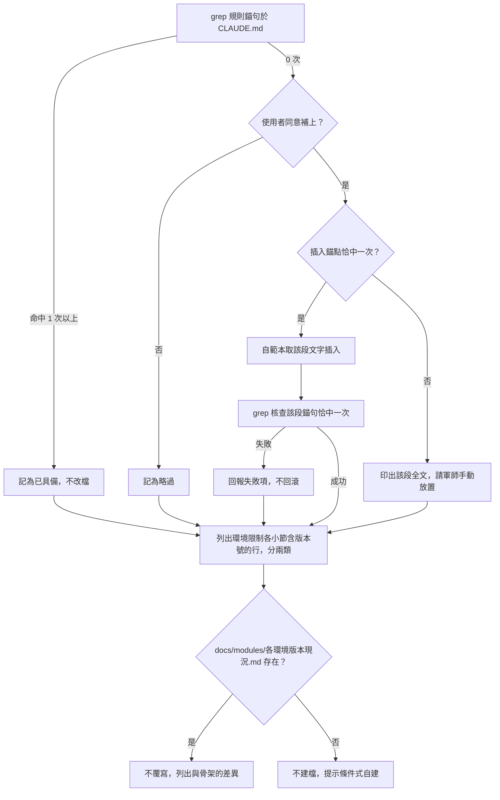

# 環境版本正本進軍師範本 - Plan

## Goal Capsule

- **Objective:** 軍師在交接或約束中引用某環境「正在執行」的版本時，讀者看得出這個版本由誰在何時、以什麼方式確認過。新建的軍師與既有軍師都適用。
- **Means:** 軍師範本加入條件式的「環境版本正本」規則與骨架檔（KTD1、KTD3），環境限制的填寫指引改為只收上限（KTD8），既有軍師經 kunsu-init 補上同一條規則（KTD5、KTD6）。
- **Product authority:** 本計畫的 Product Contract。範圍內的產品決策已由使用者於規劃對話中逐項選定，見 Key Decisions。
- **Execution profile:** 純文件與範本改動，外加 `scripts/consistency-check.sh` 的檢查項。沒有新程式、沒有新依賴。
- **Stop conditions:** 使用者審閱 ADR 006 修訂註記的候選文字後不接受時，停止 U3 的子指令部分，改採 KTD6 記載的退路後再繼續。發現規則文字必須放在 `{{PROJECT_CONSTRAINTS}}` 旁才能運作時停止並回報，因為這會破壞 add-project 與 remove-project 的錨點。
- **Tail ownership:** kunsu repo 內的改動、部署與暫存目錄演練由執行本計畫的 session 完成。各 live 軍師的實際遷移由使用者在該軍師自己的 session 發起，本計畫不寫入任何 live 軍師。

---

## Product Contract

### Summary

軍師範本新增一條規則：實際執行的環境版本只記在一份正本裡，每列帶查證日期與來源層級，其他文件一律連結到正本。正本採條件式自建，範本只附骨架。既有軍師可用 kunsu-init 的遷移步驟補上這條規則。

### Problem Frame

ebook 軍師在 2026-11-22 自行建立了 `docs/modules/各環境版本現況.md`，起因是四個反覆出現的問題。

第一，軍師依過時版本寫交接約束。接手方照約束實作後才發現環境早已升版，只能發更正交接。第二，版本號散寫在軍師 `CLAUDE.md` 的環境限制段、各 deploy playbook 與子專案文件，改一處時其餘靜默過時。第三，交接回覆寫「已部署」屬二手資訊，卻被當成已確認的事實引用，回覆之間還會互相矛盾。第四，每條工作線開工前軍師都要重新蒐集一次版本。

這份文件針對上述問題而建，但它在 2026-11-22 才建立，成效尚未經實際引用驗證，而且是單一軍師的手工產物。其他軍師沒有這份文件，新建的軍師也不會有。現行範本的環境限制題只說「特殊限制或已知約束」，沒有說執行中的精確版本該寫在哪，填寫者自然把它寫進約束段。ebook 的環境限制段就同時寫著上限（PHP 8.2）與執行中版本（8.2.36、11.4.13、6.2.21）。

### Key Decisions

- **條件式自建，不在 scaffold 時建檔。** (session-settled: user-directed — chosen over「scaffold 即產空骨架」與「訪談加一題判斷」: 沒有部署環境的軍師不該留一份空檔，訪談也不該變長) Governs R5.
- **單一正本，其他位置連結不抄號。** (session-settled: user-directed — chosen over「保留各處並以腳本機械比對」與「維持重複位置清單」: 版本號只要存在兩份就會漂移) Governs R1.
- **環境限制段只留上限與理由。** (session-settled: user-approved — chosen over「只加正本規則、不動約束段」: 約束段繼續收精確版本號就會長出第二份) Governs R6, R7.
- **不加過時提示。** (session-settled: user-directed — chosen over「沙盤顯示查證距今天數」與「寫交接時 stderr 提示」: 維持引用前自己看查證日期) Governs R2.
- **不動 handoff skill 的 done 查核。** (session-settled: user-directed — chosen over「done 收尾加版本現況更新查核項」: 本次只做範本) Governs Scope Boundaries.
- **既有軍師遷移併入本次。** (session-settled: user-directed — chosen over「另立一案」: 沒有遷移路徑，既有軍師吃不到新規則) Governs R8, R9, R10, R11, R12.

### Requirements

**規則與骨架**

- R1. 範本含一條規則：引用某環境正在執行的版本前先讀正本；軍師的其他文件寫到執行中版本時連結到正本，不抄版本號。
- R2. 規則規定單一的引用措辭，使違規一眼可辨：引用一律寫成「依環境版本正本記載」並帶查證日期與來源層級；沒有連結到正本的執行中版本號視同未查證。規則附理由。
- R3. 規則明文區分兩件事：功能做到哪以原始碼為準，執行中的版本以實查為準。原始碼宣告的版本不代表已部署。
- R4. 骨架檔提供正本的完整格式：四級來源層級（實查、原始碼、常駐文件、回覆）、「最後查證」欄的日期語意、每服務一節的表格、查證方法、尚未記錄的項目、更新時機。更新時機含一條：某列的執行中版本更新後，檢討軍師 `CLAUDE.md` 環境限制段中由該版本導出的上限。
- R5. 正本採條件式自建，路徑固定為軍師的 `docs/modules/各環境版本現況.md`：scaffold 不建立正本檔；軍師第一次要引用執行中版本而正本不存在時，才依骨架建立。

**環境限制的填寫指引**

- R6. 所有收集環境限制的入口都指示只填上限與理由，精確版本號歸正本。精確版本號指環境實際執行的建置層級版本，即修補版號或映像 tag（例：8.2.36、`redis:6.2.21-alpine`）；主版本.次版本形式的上限（例：「PHP 8.2 語法上限」）屬於合法的約束。
- R7. 軍師核准申請時，申請的環境限制若含精確版本號，先改寫成上限再寫入軍師 `CLAUDE.md`。移出的精確版本在正本已存在時記為一列，來源層級為「回覆」並註明申請檔名；正本不存在時不建檔，只在審核摘要提示該版本尚未入正本。

**既有軍師**

- R8. 既有軍師執行 add-project 時，舊版偵測會提議補上 R1 的規則。
- R9. 既有軍師不新增子專案也能補上規則：有一個可直接叫用的進入點。
- R10. 遷移可重複執行而不重複插入；插入位置無法唯一定位時不硬插，改為回報並交由軍師手動放置；失敗時明確回報，不回滾。
- R11. 遷移列出環境限制各小節中含版本號的行，分成「精確版本號（待移入正本）」與「主次版本（可能是上限）」兩類，供軍師自行改寫。遷移本身不改寫這些行，不改動小節標題，不掃描、不修改 playbook 等其他文件。
- R12. 軍師已有正本檔時，遷移不覆寫，只列出它與骨架的差異供軍師決定。

**一致性**

- R13. 一致性檢查能抓到三種漂移：範本規則錨句遺失或重複、骨架檔出現 agent 專屬路徑字面、環境限制指引的六處副本有任一處缺新措辭。
- R14. ADR 006 Decision 5 的條文與實作不互相矛盾。
- R15. 母體文件（`CLAUDE.md` 專案結構、`README.md`、操作教學、`CONCEPTS.md`、開發日誌）反映本次改動。

### Scope Boundaries

**不做（已考慮）**

- 刷新正本的獨立指令（暫名 kunsu-versions）。使用者指定另案；正本實際用過幾輪、確認手動更新會漏之後再評估。
- 任何過時提示（沙盤顯示、產檔 stderr、hook）。使用者選定不加。
- handoff skill 的任何改動，包含 done 查核。
- 遷移代為改寫或搬移環境限制段的版本號。哪句是約束、哪句是現況要逐條判斷，無法機械判定；不代做的後果只是軍師自行改幾行。出現多座軍師都放著清單不處理的證據時再評估。
- 遷移掃描或修改 playbook 等其他文件中重複的版本號。留給各軍師自行收斂。
- 修改 ebook 軍師或任何 live 軍師的檔案。Invariant 2 與 4；遷移由各軍師自己的 session 執行。
- 新 ADR。本次不改變唯讀、純 skill、信箱協議任何一條；與 ADR 006 Decision 5 的字面衝突以修訂註記處理（KTD6）。

#### Deferred to Follow-Up Work

- 「副官慣例」章節標題的正名。該章 `kunsu-claude.md:60-62` 三條規則與副官無關，新規則放進去會延續這個歸類問題。
- `scripts/consistency-check.sh` 檔頭註解補列已實作的 Q、T 項。
- `PLACEHOLDERS.md` 中 `{{PLANNER_ROOT_PATH}}` 的過時敘述（範本內該佔位符出現 0 次）。

### Success Criteria

- 以現行範本 scaffold 一個新軍師：其 `CLAUDE.md` 含 R1 的規則，`docs/modules/` 下沒有正本檔。
- 使用者在 ebook 軍師的 session 執行遷移後：ebook 的 `CLAUDE.md` 多出規則，既有的 `docs/modules/各環境版本現況.md` 內容未被改動，遷移回報列出環境限制段含版本號的行。
- 同一軍師再執行一次遷移，回報「已具備」，`CLAUDE.md` 無新增差異。

---

## Planning Contract

### Key Technical Decisions

- KTD1. **規則落點是「副官慣例」章節的一條 bullet，置於「子專案實作現況以原始碼為準」與「線進度以線總表為起點」之間。** 觸發時刻是回報或撰寫交接的當下，不是工作流程的一步，與相鄰兩條同型。不放在 `{{PROJECT_CONSTRAINTS}}` 旁：add-project 以「環境限制段落末尾」為 append 錨點，remove-project 以「標題行至下一個標題」為刪除邊界，固定文字放在那裡會被誤附或誤刪（`skills/kunsu-init/SKILL.md:540`、`:740`）。
- KTD2. **引用措辭沿用既有兩態，不另創。** 正本是軍師自寫的中介文件，引用它仍屬「依 X 記載」。引用措辭只有一種形式：「依環境版本正本記載（查證日、來源層級）」。來源層級為實查的列，效力等同既有的「已查」；其餘三級等同「未查」。用詞沿用「時點快照」「二手資訊」「視同未查證」（`docs/solutions/workflow-issues/assertion-level-discipline-coverage-gap.md`）。新概念在範本、骨架與 CONCEPTS 一律稱「環境版本正本」，不換用「權威版本」「單一來源」，也不單寫「正本」：ebook 軍師的 `CLAUDE.md` 已用「正本」指稱 solutions 文件與維運腳本。本計畫內文的「正本」是這個詞的簡稱。
- KTD3. **規則 bullet 內直接寫出正本的最小表頭，完整格式才指向骨架檔。** 開發日誌 2026-09-28 記載純指路句零兌現、可貼上的骨架被採用。骨架檔的指路寫成 `<部署目錄>/kunsu-init/assets/templates/kunsu-env-versions.md`，比照 `kunsu-claude.md:143` 的先例；一致性檢查 L 項禁止 `~/.claude/skills` 字面（ADR 019）。
- KTD4. **骨架的來源欄以「角色代碼＋repo 相對路徑」指位置，不寫絕對路徑。** 絕對路徑會讓正本成為 Invariant 2 之外的第三個機器路徑常設登記處。骨架的待填處用 `<…>` 角括號，不用 `{{…}}`，避免成為 `PLACEHOLDERS.md` 所禁止的孤兒佔位符。
- KTD5. **舊版偵測改用錨句 grep，錨句是規則 bullet 的粗體首句，含粗體標記：`**環境版本以正本為起點**`。** 交接撰寫步驟的指向句不得含這個字面，改以「副官慣例的環境版本規則」指稱並有自己的錨句，否則「恰中一次」的核查會誤判（`skills/kunsu-init/SKILL.md:389` 有同類先例）。 既有的 ②-a、②-b 以目錄存在與否偵測，但正本是條件式自建，沒有目錄可看。錨句偵測天然冪等，文字補失敗時下次會重試。範本、SKILL.md 的偵測與核查、一致性檢查三處使用同一字面。
- KTD6. **遷移有兩個進入點：add-project 的 ②-c，以及新子指令 `sync-rules`。** (session-settled: user-approved — chosen over「只掛在 add-project」: 不新增子專案的軍師永遠不會觸發偵測) 子指令只做身分驗證後執行 ②-c 的同一段步驟，步驟本體只寫一份。此決策與 ADR 006 Decision 5「不做獨立遷移指令」字面衝突；當時的前提是只有兩座軍師、遷移皆伴隨新增子專案，現況是規則型遷移沒有對應的新增動作。處理方式是 U4 的修訂註記 (session-settled: user-directed — chosen over「不做子指令」與「另開新 ADR」: 規則型遷移需要直接進入點，放寬範圍小到不必另立 ADR)；註記的實際文字仍須經使用者審定才落地。**退路：** 使用者不接受註記文字且無法修到可接受時，刪除子指令。此時 R9 不成立，改記為已知限制：既有軍師只能執行 add-project、於 ②-c 完成後在訪談步驟中止，操作教學寫明這個用法。
- KTD7. **遷移只寫入 `CLAUDE.md` 的兩處文字：規則 bullet 與交接撰寫步驟的指向句。** 兩處各自偵測、各自插入。插入前以 `grep -cF` 確認該處的插入錨點恰中一次；非一次時視為在地客製，印出該段全文請軍師手動放置。遷移不建立、不修改正本檔。確認 commit 的 pathspec 只帶 `CLAUDE.md`，不用寬範圍 `git add`（ADR 017、018）。
- KTD8. **環境限制指引的六處副本一起改，並在核准點加一道改寫。** 收集點：`skills/kunsu-init/SKILL.md` 主流程訪談、同檔 add-project 訪談退路、`skills/kunsu-apply/SKILL.md`、`PLACEHOLDERS.md` 的佔位符列與訪談對照列、範本申請信箱協議的 `constraints` 欄說明。上限與精確版本號的分界依 R6。申請的 `constraints` 會經 add-project 逐字寫進軍師 `CLAUDE.md`，只改收集點擋不住既有申請，所以審核摘要處加一句核准前改寫（R7）。
- KTD9. **不加提示機制，以文字規則的可辨性補強。** (session-settled: user-directed — chosen over 工具提示: 見 Key Decisions) **衝突註記：** 本專案有同形的失效先例。開發日誌 2026-09-28 記載條件式線總表規則上線後 139 次產檔零次被喚起，2026-09-01 記載文件層機制全數失效過。本決策照使用者選定執行，補強僅限文字層：R2 的單一引用措辭讓違規可辨，交接撰寫步驟加一句指向規則；既有軍師經遷移同樣取得這兩處文字（KTD7）。失效的觀察方式見 Risks。
- KTD10. **一致性檢查 H 鏈加入規則錨句。** H 鏈對 registry 中的 live 軍師逐一檢查，未遷移者得到 WARN。這是 kunsu repo 內的檢查，訊號給工具維護者，不是軍師 session 的提示，不違反 KTD9。
- KTD11. **版號：kunsu-init 0.10.0 → 0.11.0（新增子指令），kunsu-apply 0.2.0 → 0.2.1（指引文字）。** 比照 remove-project 新增時升 minor 的先例。

### High-Level Technical Design

②-c 遷移段的判斷流程。add-project 與 `sync-rules` 共用。

A 到 I 對規則 bullet 與指向句各執行一次。②-c 在 L 或 M 結束，結果記為已具備、已補上、略過、需手動放置四態之一，不自帶 commit：add-project 由既有的收尾步驟回報並確認 commit，`sync-rules` 由自己的收尾步驟處理。已具備規則的軍師仍會走到「列出含版本號的行」，因為規則補上不代表環境限制段已整理完。

### Assumptions

- 各 live 軍師的 `CLAUDE.md` 仍保有兩個插入錨點：「子專案實作現況以原始碼為準」bullet，以及交接撰寫步驟的「撰寫指引（斷言層級紀律、引用檔名權威、更正交接）」bullet。不成立時該處走手動放置分支，不影響其他步驟。
- 精確版本號可用「三段數字」或「映像名:tag」樣式找出，主次版本可用「兩段數字」樣式找出。樣式會誤列非版本的數字（如日期），清單只供軍師檢視，誤列可接受。

### Sequencing

U1 先定規則錨句與骨架檔名，其餘單元引用它們。U4 的註記候選須在 U3 的子指令部分落地前經使用者確認。U5 依賴 U1、U2、U3 的最終字面。U6 最後。

---

## Implementation Units

### U1. 範本規則、骨架檔與範本詞條

- **Goal:** 範本具備 R1–R5 的規則與骨架。
- **Requirements:** R1, R2, R3, R4, R5
- **Dependencies:** 無
- **Files:**
  - `skills/kunsu-init/assets/templates/kunsu-claude.md`（修改）
  - `skills/kunsu-init/assets/templates/kunsu-env-versions.md`（新增）
  - `skills/kunsu-init/assets/templates/kunsu-concepts.md`（修改）
  - `skills/kunsu-init/assets/templates/PLACEHOLDERS.md`（修改）
- **Approach:**
  1. 在 `kunsu-claude.md` 依 KTD1 的位置新增規則 bullet，粗體首句為 KTD5 的錨句。內容依序為：何時讀正本與正本的固定路徑（R5）、正本不存在時依骨架建立、引用措辭（KTD2）、其他文件連結不抄號、正本某列更新後檢討由它導出的上限（R4）、與相鄰 bullet 的分工（R3）、最小表頭（KTD3）、骨架檔位置、理由。
  2. 在工作流程第 5 步「拆解為交接文件」的清單加一句，指向這條規則，不重述內容，措辭依 KTD5 的限制。
  3. 文件導航表 `docs/modules/` 列補上正本的路徑與「首次引用時自建」。
  4. 新增骨架檔。以 ebook 軍師的 `docs/modules/各環境版本現況.md` 為藍本通用化：保留 frontmatter、使用規則、來源層級、每服務一節的表格、查證方法、尚未記錄的項目、更新時機；刪除「建立時發現的不一致」與「版本敘述重複位置」兩節；待填處依 KTD4。
  5. 骨架修正藍本的兩處問題。來源層級補「實查」為第一級，並寫明只有實查代表已部署的事實。「最後查證」欄定義為該列事實被確認的日期，二手來源的列寫明未實查，不填軍師讀到來源的日期。
  6. 骨架的更新時機一節含 R4 的檢討上限條目。
  7. `kunsu-concepts.md` 新增詞條「環境版本正本」，格式比照既有詞條（`### 中文名（English）`＋一段）。
  8. `PLACEHOLDERS.md` 在「無佔位符的範本」表之後另立一類，說明骨架檔只部署、不在 scaffold 時複製，由軍師首次需要時自讀。
- **Patterns to follow:** `kunsu-claude.md:62`（讀規則＋指路＋理由的單條 bullet 形狀）；`kunsu-claude.md:27`（條件式建立的措辭）；`kunsu-claude.md:143`（指向部署目錄檔案的寫法）。
- **Test scenarios:**
  - 範本中 KTD5 的錨句恰出現一次；指向句的錨句恰出現一次，且指向句不含 KTD5 的錨句字面。
  - 規則 bullet 位於 `{{PROJECT_CONSTRAINTS}}` 所在章節之外。
  - 骨架檔不含 `{{`、不含 `~/.claude`、不含以 `/Users/` 開頭的路徑。
  - 骨架檔的來源層級列出四級，且「實查」列寫明它是唯一代表已部署事實的層級。
  - 骨架檔的更新時機含檢討上限的條目。
  - 規則 bullet 寫出正本的固定路徑 `docs/modules/各環境版本現況.md`。
- **Verification:** 以範本渲染出的 `CLAUDE.md` 讀起來，一個沒看過本計畫的軍師 session 能從規則 bullet 單獨判斷何時建正本、表頭長什麼樣、引用時怎麼寫。

### U2. 環境限制填寫指引與核准改寫

- **Goal:** 精確版本號不再經任何入口流進環境限制段。
- **Requirements:** R6, R7
- **Dependencies:** U1（指引引用正本一詞）
- **Files:**
  - `skills/kunsu-init/SKILL.md`（修改：主流程訪談說明、add-project 訪談退路、add-project 審核摘要）
  - `skills/kunsu-apply/SKILL.md`（修改：收集項說明、版號）
  - `skills/kunsu-init/assets/templates/PLACEHOLDERS.md`（修改：`{{PROJECT_CONSTRAINTS}}` 列的範例、Q4 對照列）
  - `skills/kunsu-init/assets/templates/kunsu-claude.md`（修改：申請信箱協議的 `constraints` 欄說明）
- **Approach:**
  1. 六處收集點的說明改為同一句意：只填上限與理由，執行中的精確版本號歸正本；上限與精確版本號的分界依 R6。各處用語一致（KTD8）。
  2. `PLACEHOLDERS.md` 既有的範例「PHP 7.2 語法上限」是合法的上限，保留。在它旁邊補一個對照：修補版號或映像 tag 不寫在這裡。
  3. add-project 審核摘要處加入 R7 的核准改寫：環境限制含精確版本號時，核准前改寫成上限；移出的版本依正本是否存在分兩種處理。
  4. kunsu-apply 版號依 KTD11。
- **Patterns to follow:** `skills/kunsu-init/SKILL.md:79` 與 `:513` 現行的一句式說明。
- **Test scenarios:**
  - 六處收集點都含「上限」與指向正本的句子。
  - 六處收集點的說明與範例都不含三段數字的版本號，對照用的反例除外。
  - 審核摘要的改寫指示同時涵蓋「正本已存在」與「正本不存在」兩種情況。
- **Verification:** 以 kunsu-apply 投遞一份環境限制寫「MariaDB 11.4.13」的申請時，子專案端的說明會讓填寫者改寫；即使照填，軍師審核摘要處也有改寫指示。

### U3. kunsu-init 的 ②-c 遷移段與 sync-rules 子指令

- **Goal:** 既有軍師能補上規則（R8–R12）。
- **Requirements:** R8, R9, R10, R11, R12
- **Dependencies:** U1；子指令部分另依賴 U4 經使用者確認
- **Files:**
  - `skills/kunsu-init/SKILL.md`（修改：frontmatter description 與版號、add-project 新增 ②-c、新增 `## sync-rules 子指令` 區段）
- **Approach:**
  1. 在 add-project 的 ②-b 之後、統一跳轉之前新增 ②-c，流程依 High-Level Technical Design。②-c 的結果不影響既有的跳轉判斷，比照 ②-b；結果以四態記錄，供收尾步驟回報。
  2. 規則 bullet 與指向句各自偵測、插入、核查，使用各自的錨句（KTD5、KTD7）。
  3. 列出含版本號的行時，掃描所有以 `### ` 開頭且標題含「環境限制」的小節，範圍到下一個 `##` 或 `###` 標題為止。不要求標題符合 `### <顯示名稱> 環境限制` 的標準形狀：ebook 含版本號的小節標題是「### Lumen 後台環境限制（規劃時務必納入考量）」。清單依 R11 分兩類，遷移不改寫任何一行。
  4. 以 R5 的固定路徑判斷正本是否存在。存在時讀取並對照骨架，列出差異項（來源層級是否四級、「最後查證」語意、更新時機是否含檢討上限），不寫入該檔（R12）。
  5. add-project 既有的完成回報表加一列 ②-c 的結果，commit 沿用既有的收尾步驟。
  6. 新增 `sync-rules` 子指令區段：總述、必須在軍師根目錄執行的聲明、Invariant 2 邊界聲明、身分驗證（比照 remove-project 整段複製）、「執行 add-project 步驟 ②-c」、完成回報、確認 commit。②-c 的步驟不在此重寫（KTD6）。
  7. description 加一行觸發語。版號依 KTD11。
- **Execution note:** 先完成 ②-c 並以暫存目錄演練通過，再寫子指令區段。U4 未獲確認前，子指令區段不落地。
- **Patterns to follow:** `skills/kunsu-init/SKILL.md:370-398`（②-a 的偵測、三態記錄、核查與失敗回報）；`:641-665`（remove-project 的身分驗證）；`:763-778`（完成回報與確認 commit）；`:388-389`（核查字串不可縮短的誤判理由）。
- **Test scenarios:**
  - 軍師 `CLAUDE.md` 無錨句、插入錨點恰中一次：同意後規則插入於預期位置，核查錨句恰中一次。
  - 同一軍師再執行一次：判為已具備，`CLAUDE.md` 無差異。
  - 插入錨點出現 0 次（該 bullet 被在地改寫）：不插入，印出規則全文，回報需手動放置。
  - 使用者拒絕補上：記為略過，後續步驟照常。
  - 標準標題的小節有一行含「11.4.13」：該行出現在「精確版本號」類，遷移後該行位元組不變。
  - 標題為「### X後台環境限制（規劃時務必納入考量）」的小節有一行含「11.4.13」：該行同樣出現在清單中。
  - 一行只含「PHP 8.2 為上限」：出現在「主次版本」類。
  - 規則 bullet 已具備、指向句缺：只補指向句。
  - 指向句的插入錨點出現 0 次：規則 bullet 照常插入，指向句印出全文請軍師手動放置。
  - 軍師已有正本檔：檔案位元組不變，回報列出差異項。
  - 核查失敗（模擬插入後錨句仍為 0）：回報失敗項，不回滾，後續步驟照常。
  - 經 `sync-rules` 執行：待確認的 commit 指令只帶 `CLAUDE.md`，工作區另有未 commit 的回覆檔時不被夾帶。
  - 經 add-project 執行：②-c 之後沒有額外的 commit 確認，結果出現在完成回報表。
- **Verification:** 上述情境在暫存目錄的軍師副本上逐項走過，結果與預期一致。

### U4. ADR 006 Decision 5 修訂註記

- **Goal:** ADR 條文與實作不矛盾（R14）。
- **Requirements:** R14
- **Dependencies:** 無（須在 U3 子指令部分之前經使用者確認）
- **Files:**
  - `docs/adr/2026-07-07-adr-candidate-006-application-inbox-dual-mailbox.md`（修改：於 Decision 5 下加修訂註記）
- **Approach:**
  1. 先產出註記候選文字交使用者審定，審定後才寫入。
  2. 註記說明三件事：放寬的範圍（僅限以錨句偵測的規則型遷移可由 `sync-rules` 直接叫用）、原條文仍成立的部分（目錄型遷移仍內建於 add-project）、放寬的效益評估（規則型遷移沒有伴隨的新增動作，不放寬則不新增子專案的軍師無法取得規則）。
  3. 格式比照既有修訂註記（blockquote、日期、指向本計畫）。
- **Patterns to follow:** `docs/adr/2026-07-11-adr-candidate-010-dashboard-service-exception.md:29-47` 的修訂註記寫法。
- **Test expectation:** none -- 純文件；註記內容由使用者審定。
- **Verification:** ADR 006 Decision 5 與 `skills/kunsu-init/SKILL.md` 的子指令清單並讀時沒有矛盾。使用者否決時，本單元改為不修改 ADR，並執行 KTD6 的退路。

### U5. 一致性檢查

- **Goal:** R13 的三種漂移可被機械抓到，live 軍師的遷移狀態可見。
- **Requirements:** R13
- **Dependencies:** U1, U2, U3
- **Files:**
  - `scripts/consistency-check.sh`（修改）
- **Approach:**
  1. L 項的檔案清單加入骨架檔。
  2. 新增 U 項，以 `grep -cF` 核對：範本規則錨句恰一次；`skills/kunsu-init/SKILL.md` 含同一錨句（偵測與核查）；骨架檔存在且列出四級來源；環境限制指引六處皆含新措辭；指向句錨句恰一次且不含規則錨句字面。檔頭註解補列 U。
  3. H 鏈的錨字串接加入規則錨句（KTD10）。
- **Patterns to follow:** `scripts/consistency-check.sh:414-428`（Q 項的錨句計數寫法與訊息帶系統後果的慣例）；`:439`（H 鏈）。
- **Test scenarios:**
  - 全部改動完成後執行檢查：U 項 ok，無新增 FAIL。
  - 把範本的規則錨句改掉一個字：U 項 FAIL。還原。
  - 在骨架檔加入 `~/.claude/skills`：L 項 FAIL。還原。
  - 刪掉六處收集點其中一處的新措辭：U 項 FAIL。還原。
  - 未遷移的 live 軍師：H 鏈對它發 WARN 並指出缺規則錨句。
- **Verification:** 上述負向實驗每項都觀察到預期的 FAIL 或 WARN，還原後恢復 ok。

### U6. 母體文件同步、部署與演練

- **Goal:** 母體文件反映改動（R15），部署樹與原始碼一致，Success Criteria 可驗。
- **Requirements:** R15
- **Dependencies:** U1, U2, U3, U4, U5
- **Files:**
  - `CLAUDE.md`（修改：專案結構的 kunsu-init 兩行、ADR 狀態敘述如受影響）
  - `README.md`（修改：工具表）
  - `docs/playbooks/end-to-end-workflow.md`（修改：子指令段）
  - `CONCEPTS.md`（修改：新增「環境版本正本」詞條；「遷移波次」詞條補一句說明自助遷移與它並存）
  - `docs/history/development-log.md`（追加一條）
- **Approach:**
  1. 依上列檔案同步。開發日誌條目比照最末兩條的單行格式，寫明來源、落地項、未改 live 軍師的理由，以及 KTD9 的觀察項。
  2. 執行 `install.sh` 部署，確認部署樹含骨架檔與新版 SKILL.md。
  3. 在暫存目錄 scaffold 一個新軍師，核對 Success Criteria 第一項。
  4. 重啟常駐沙盤（部署後的既定步驟）。
- **Test expectation:** none -- 純文件與部署；由 U5 的一致性檢查與暫存目錄演練驗證。
- **Verification:** 一致性檢查全數 ok（live 軍師的 H 鏈 WARN 屬預期）；暫存目錄的新軍師符合 Success Criteria 第一項；向使用者交付在 ebook 軍師執行遷移的指令與其目的。

---

## Verification Contract

| 檢查 | 指令或方式 | 適用單元 | 通過訊號 |
|---|---|---|---|
| 一致性檢查 | `bash scripts/consistency-check.sh` | 全部 | 無 FAIL；新增的 U 項 ok；H 鏈僅對未遷移的 live 軍師 WARN |
| 負向實驗 | 逐一改壞錨句、骨架字面、收集點措辭後執行一致性檢查 | U5 | 每項都觀察到 FAIL，還原後恢復 |
| 遷移演練 | 暫存目錄內的軍師副本，依 U3 的情境逐項走 | U3 | 每個情境結果與預期一致 |
| scaffold 演練 | 暫存目錄以新版範本建立軍師 | U1, U6 | `CLAUDE.md` 含規則錨句一次；`docs/modules/` 無正本檔 |
| 部署核對 | 部署後以 `grep -c` 查部署樹 | U6 | 部署樹的骨架檔存在、SKILL.md 含錨句 |
| 既有測試 | `uv run pytest`（`skills/kunsu-inbox/tests`、`skills/kunsu-dashboard/tests`） | 全部 | 與改動前相同；本次未觸及其涵蓋範圍 |

kunsu-init 的 SKILL.md 與範本文字沒有自動測試，本計畫不為此新建測試框架。

---

## Definition of Done

- R1–R15 皆有對應的落地改動，U1–U6 的 Verification 皆成立。採 KTD6 退路時 R9 除外，並已記為已知限制。
- Verification Contract 各列通過。
- ADR 006 的修訂註記已由使用者審定並落地，或已依 KTD6 的退路改寫 U3 與操作教學。
- 負向實驗的改壞內容全數還原，暫存目錄已清除，diff 中沒有演練殘留。
- 未修改任何 live 軍師與 ebook 母本的檔案。
- 已向使用者交付在 ebook 軍師執行遷移的指令，並說明預期結果代表的意義。

---

## Risks

- **規則從未被喚起而正本始終沒建立。** KTD9 記載的先例顯示這是最可能的失效，而且不留訊號。觀察方式：遷移後一段時間，檢查各軍師新發的交接是否出現未連結正本的執行中版本號。出現時代表文字規則不足，屆時重啟「刷新指令」或提示機制的另案評估。
- **骨架格式源自尚未使用過的藍本。** ebook 遷移後的實際引用若顯示格式需要調整，骨架、U5 的檢查項與 R12 的差異項要一起修改。
- **在地客製使插入錨點失效。** 已由 KTD7 的手動放置分支承接，不會造成錯誤插入。
- **live 軍師的 H 鏈 WARN 長期存在。** 屬預期訊號；各軍師遷移後消失。

## Sources

- 藍本：ebook 軍師的 `docs/modules/各環境版本現況.md`（唯讀參考，Invariant 4）。
- 條件式自建的先例計畫：`docs/plans/2026-09-28-1117-feat-conditional-series-index-plan.md`。
- 失效先例：`docs/history/development-log.md` 2026-08-15、2026-08-29、2026-09-01、2026-09-28 各條。
- 既有措辭：`docs/solutions/workflow-issues/assertion-level-discipline-coverage-gap.md`、`CONCEPTS.md`「斷言層級紀律」。
- 遷移先例與坑：`skills/kunsu-init/SKILL.md:370-428`、`docs/solutions/workflow-issues/literal-replacement-residue-and-review-triage.md`、`docs/solutions/workflow-issues/handoff-done-closure-gap.md`。
